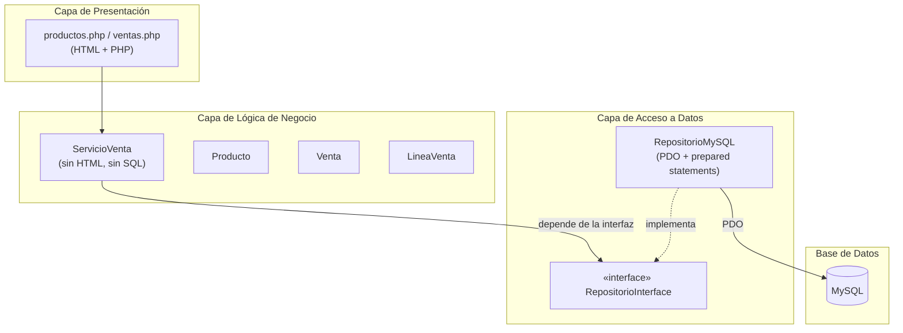
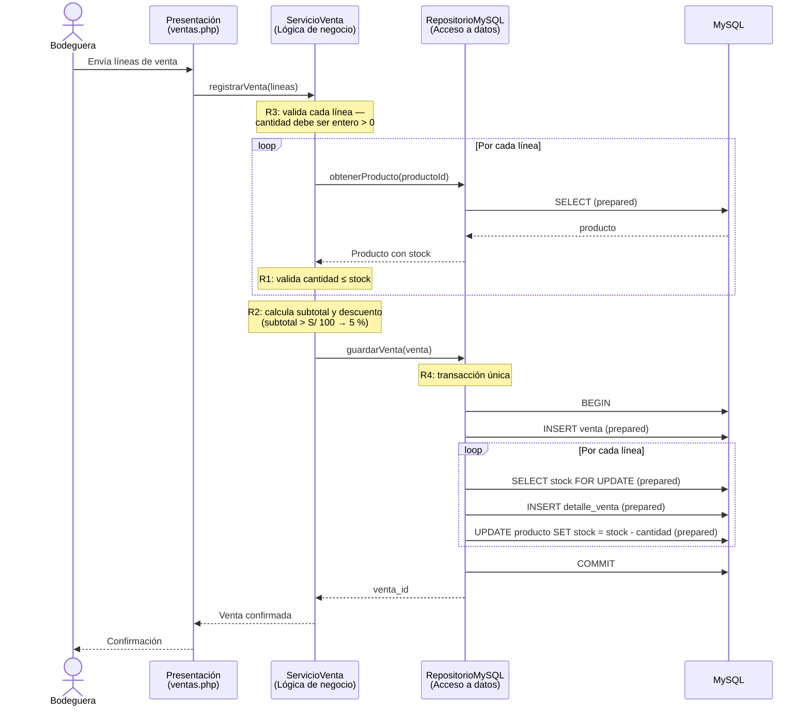

# Design Document — Registro de ventas de la bodega «Doña Rosa»

## Overview

El diseño define la arquitectura y los componentes del Sistema de registro de ventas de la bodega «Doña Rosa». El sistema permite registrar productos, consultar el catálogo con stock disponible, registrar ventas con una o varias líneas, aplicar el descuento por volumen automáticamente y descontar el stock de cada producto al confirmar la venta.

La arquitectura sigue un patrón de tres capas en PHP 8 sin framework: presentación, lógica de negocio y acceso a datos. La separación se apoya en una interfaz de repositorio que desacopla `ServicioVenta` de `RepositorioMySQL`, de modo que toda la lógica de negocio sea probable con PHPUnit **sin base de datos**, inyectando un doble de prueba (mock/stub) que implementa la misma interfaz.

Las reglas de negocio R1–R4 del documento D0 se distribuyen entre las capas según su naturaleza:

- **R3** (cantidad debe ser entero mayor que cero) y **R1** (no vender más del stock disponible) son validaciones de lógica de negocio: residen en `ServicioVenta`.
- **R2** (descuento del 5 % si el subtotal supera S/ 100) es un cálculo puro: reside en `ServicioVenta`.
- **R4** (descontar el stock en la misma transacción) es una preocupación de acceso a datos: reside en `RepositorioMySQL`.

## Architecture

### Patrón de tres capas



**Capa de Presentación** — Archivos `.php` con HTML en la raíz del proyecto. Reciben la entrada del usuario mediante formularios, invocan a `ServicioVenta` y renderizan el resultado. No contienen lógica de negocio ni SQL. Archivos previstos: `index.php` (menú principal), `productos.php` (registro y listado de productos), `ventas.php` (registro de ventas).

**Capa de Lógica de Negocio** — Clases PHP en `src/`. Contiene `ServicioVenta`, el orquestador de todas las operaciones, y las entidades `Producto`, `Venta` y `LineaVenta`. `ServicioVenta` no genera HTML ni ejecuta SQL; depende de `RepositorioInterface` para toda persistencia.

**Capa de Acceso a Datos** — `RepositorioMySQL` en `src/`, que implementa `RepositorioInterface` usando PDO con sentencias preparadas. Es la única clase que interactúa con MySQL.

### Inyección de dependencias

`ServicioVenta` recibe una instancia de `RepositorioInterface` en su constructor:

```
ServicioVenta(RepositorioInterface $repositorio)
```

En producción, la capa de presentación construye un `RepositorioMySQL` (con una conexión PDO desde `config/env.php`) y lo inyecta en `ServicioVenta`. En los tests, se inyecta un mock que implementa la misma interfaz, lo que permite probar toda la lógica de negocio sin base de datos. Esta es la restricción crítica del diseño: `ServicioVenta` nunca referencia a `RepositorioMySQL` directamente.

### Distribución de las reglas R1–R4

| Regla | Descripción | Capa responsable | Componente |
|-------|-------------|-----------------|------------|
| R1 | No vender una cantidad mayor al stock disponible | Lógica de negocio | `ServicioVenta` |
| R2 | Descuento del 5 % si el subtotal > S/ 100 | Lógica de negocio | `ServicioVenta` |
| R3 | La cantidad debe ser un entero mayor que cero | Lógica de negocio | `ServicioVenta` |
| R4 | Stock se descuenta en la misma transacción | Acceso a datos | `RepositorioMySQL` |

### Decisión de diseño: precisión monetaria

Los cálculos monetarios (subtotal, descuento, total) usan `float` en PHP con `round($valor, 2)` en cada paso aritmético para garantizar dos decimales. Alternativamente, se puede usar la extensión `bcmath` (incluida en PHP, no es una librería externa) si se detectan problemas de precisión. Esta decisión se documenta para que los tests de propiedades tengan en cuenta el redondeo.

## Components and Interfaces

### RepositorioInterface

Interfaz que abstrae toda la persistencia. `ServicioVenta` depende exclusivamente de esta interfaz, lo que permite inyectar un doble de prueba en los tests de PHPUnit.

```php
interface RepositorioInterface
{
    // --- Productos ---
    /** @return int ID generado */
    public function guardarProducto(Producto $producto): int;

    /** @return Producto[] */
    public function listarProductos(): array;

    /** @return Producto|null */
    public function obtenerProducto(int $id): ?Producto;

    // --- Ventas ---
    /**
     * Persiste la venta de forma atómica (R4):
     * inserta venta + detalles y reduce el stock en una transacción.
     * @return int ID de la venta generada
     * @throws ExcepcionStockInsuficiente si el stock no alcanza dentro de la transacción
     */
    public function guardarVenta(Venta $venta): int;
}
```

**Decisiones de la interfaz:**

- No expone métodos de transacción (`iniciarTransaccion`, `commit`, `rollback`). La transacción es interna a `RepositorioMySQL.guardarVenta`, de modo que `ServicioVenta` no conoce detalles de infraestructura.
- `obtenerProducto` devuelve `?Producto` (null si no existe), permitiendo que `ServicioVenta` valide la existencia del producto antes de operar.
- `guardarVenta` recibe una `Venta` ya construida (con subtotal, descuento y total calculados por `ServicioVenta`) y se encarga únicamente de persistir y reducir stock atómicamente.

### RepositorioMySQL

Implementa `RepositorioInterface` usando PDO con sentencias preparadas. Recibe la conexión PDO en el constructor.

```php
class RepositorioMySQL implements RepositorioInterface
{
    public function __construct(private PDO $conexion) {}

    // ... implementa todos los métodos de la interfaz
}
```

**`guardarVenta` — implementación de R4:**

1. `BEGIN TRANSACTION`
2. `INSERT INTO venta (subtotal, descuento, total, fecha) VALUES (?, ?, ?, ?)` — sentencia preparada
3. Por cada `LineaVenta`:
   - `SELECT stock FROM producto WHERE id = ? FOR UPDATE` — bloqueo pesimista y re-validación de stock dentro de la transacción
   - Si `cantidad > stock`: `ROLLBACK` y lanzar `ExcepcionStockInsuficiente`
   - `INSERT INTO detalle_venta (venta_id, producto_id, cantidad, precio_unitario) VALUES (?, ?, ?, ?)`
   - `UPDATE producto SET stock = stock - ? WHERE id = ?` — sentencia preparada
4. `COMMIT`
5. Devuelve el ID de la venta generada

El `SELECT ... FOR UPDATE` re-valida R1 dentro de la transacción como defensa adicional: aunque `ServicioVenta` ya validó el stock antes de crear la `Venta`, el repositorio lo confirma nuevamente para garantizar la integridad de los datos.

### ServicioVenta

Orquesta todas las operaciones de negocio. No contiene HTML ni SQL. Depende de `RepositorioInterface`.

```php
class ServicioVenta
{
    public function __construct(private RepositorioInterface $repositorio) {}

    /** @throws ExcepcionProductoInvalido */
    public function registrarProducto(string $nombre, float $precio, int $stock): Producto;

    /** @return Producto[] */
    public function consultarCatalogo(): array;

    /** @param LineaVenta[] $lineas
     *  @throws ExcepcionVentaInvalida | ExcepcionCantidadInvalida | ExcepcionStockInsuficiente
     *  @return Venta */
    public function registrarVenta(array $lineas): Venta;
}
```

**`registrarProducto`:**

1. Valida el nombre: entre 1 y 100 caracteres, no vacío ni solo espacios.
2. Valida el precio: entre S/ 0.01 y S/ 999,999.99.
3. Valida el stock: entero entre 0 y 999,999,999.
4. Si algún campo es inválido, lanza `ExcepcionProductoInvalido` indicando el campo.
5. Crea un `Producto` y lo persiste mediante `$this->repositorio->guardarProducto()`.
6. Devuelve el `Producto` con su ID generado.

**`registrarVenta`:**

1. Valida que haya al menos una línea. Si no, lanza `ExcepcionVentaInvalida` (Req 3.5).
2. Por cada línea, valida **R3**: la cantidad debe ser un entero mayor que cero. Si no, lanza `ExcepcionCantidadInvalida` sin modificar stock (Req 3.2).
3. Por cada línea, obtiene el producto del repositorio y valida **R1**: cantidad ≤ stock. Si la cantidad excede el stock, lanza `ExcepcionStockInsuficiente` sin modificar stock (Req 3.3). Si la cantidad es igual al stock, la línea se acepta (Req 3.4).
4. Calcula el subtotal: Σ (precio unitario × cantidad) con `round(..., 2)`.
5. Aplica **R2**: si `subtotal > 100`, `descuento = round(subtotal * 0.05, 2)` y `total = round(subtotal - descuento, 2)`. Si `subtotal <= 100`, `descuento = 0` y `total = subtotal`.
6. Crea la entidad `Venta` con todas las líneas, subtotal, descuento y total.
7. Llama a `$this->repositorio->guardarVenta($venta)` para persistir atómicamente (**R4**).
8. Devuelve la `Venta` con su ID generado.

### Entidades

**Producto** (entidad):

```php
class Producto
{
    public function __construct(
        public readonly string $nombre,
        public readonly float $precio,
        public readonly int $stock,
        public readonly ?int $id = null
    ) {}
}
```

**LineaVenta** (value object):

```php
class LineaVenta
{
    public function __construct(
        public readonly int $productoId,
        public readonly int $cantidad,
        public ?Producto $producto = null  // cargado al validar
    ) {}

    /** Subtotal de la línea = precio × cantidad */
    public function subtotal(): float;
}
```

**Venta** (entidad agregada):

```php
class Venta
{
    public function __construct(
        public readonly array $lineas,     // LineaVenta[]
        public readonly float $subtotal,
        public readonly float $descuento,
        public readonly float $total,
        public readonly ?int $id = null
    ) {}
}
```

### Excepciones

```php
class ExcepcionProductoInvalido extends RuntimeException
{
    public function __construct(public readonly string $campo) {}
}

class ExcepcionVentaInvalida extends RuntimeException {}
class ExcepcionCantidadInvalida extends ExcepcionVentaInvalida {}
class ExcepcionStockInsuficiente extends ExcepcionVentaInvalida
{
    public function __construct(public readonly int $productoId) {}
}
```

## Data Models

### Tabla `producto`

| Columna  | Tipo             | Restricciones                                    |
|----------|------------------|--------------------------------------------------|
| `id`     | `INT`            | PK, `AUTO_INCREMENT`                             |
| `nombre` | `VARCHAR(100)`   | `NOT NULL`                                       |
| `precio` | `DECIMAL(10,2)`  | `NOT NULL`                                       |
| `stock`  | `INT UNSIGNED`   | `NOT NULL`, `DEFAULT 0`                          |

### Tabla `venta`

| Columna    | Tipo             | Restricciones                                |
|------------|------------------|----------------------------------------------|
| `id`       | `INT`            | PK, `AUTO_INCREMENT`                         |
| `subtotal` | `DECIMAL(10,2)`  | `NOT NULL`                                   |
| `descuento`| `DECIMAL(10,2)`  | `NOT NULL`, `DEFAULT 0.00`                   |
| `total`    | `DECIMAL(10,2)`  | `NOT NULL`                                   |
| `fecha`    | `DATETIME`       | `NOT NULL`, `DEFAULT CURRENT_TIMESTAMP`      |

### Tabla `detalle_venta`

| Columna          | Tipo             | Restricciones                               |
|------------------|------------------|---------------------------------------------|
| `id`             | `INT`            | PK, `AUTO_INCREMENT`                        |
| `venta_id`       | `INT`            | FK → `venta(id)`, `NOT NULL`, `ON DELETE CASCADE` |
| `producto_id`    | `INT`            | FK → `producto(id)`, `NOT NULL`             |
| `cantidad`       | `INT UNSIGNED`   | `NOT NULL`                                  |
| `precio_unitario`| `DECIMAL(10,2)`  | `NOT NULL`                                  |

**Nota:** `detalle_venta.precio_unitario` captura el precio del producto al momento de la venta, independientemente de cambios posteriores en `producto.precio`. Esto garantiza la integridad histórica de los montos.

### Diagrama entidad-relación

```mermaid
erDiagram
    producto ||--o{ detalle_venta : "aparece en"
    venta ||--o{ detalle_venta : "contiene"

    producto {
        INT id PK
        VARCHAR(100) nombre
        DECIMAL(10,2) precio
        INT stock
    }
    venta {
        INT id PK
        DECIMAL(10,2) subtotal
        DECIMAL(10,2) descuento
        DECIMAL(10,2) total
        DATETIME fecha
    }
    detalle_venta {
        INT id PK
        INT venta_id FK
        INT producto_id FK
        INT cantidad
        DECIMAL(10,2) precio_unitario
    }
```

### Diagrama de secuencia — Registrar venta



El diagrama muestra dónde se valida cada regla:

- **R3** (cantidad entera > 0): en `ServicioVenta`, antes de consultar el repositorio. Si falla, se rechaza la venta sin tocar la base de datos.
- **R1** (cantidad ≤ stock): en `ServicioVenta`, consultando el stock del producto. Si falla, se rechaza sin modificar stock. El repositorio re-valida R1 dentro de la transacción con `SELECT ... FOR UPDATE`.
- **R2** (descuento 5 %): en `ServicioVenta`, como cálculo puro sobre el subtotal.
- **R4** (transacción): en `RepositorioMySQL`, que ejecuta `BEGIN`, inserta venta y detalles, reduce stock y `COMMIT` en una sola transacción.

## Correctness Properties

*A property is a characteristic or behavior that should hold true across all valid executions of a system — essentially, a formal statement about what the system should do. Properties serve as the bridge between human-readable specifications and machine-verifiable correctness guarantees.*

Las siguientes propiedades se aplican a la lógica de negocio de `ServicioVenta`, probada con un doble de prueba (mock) que implementa `RepositorioInterface`, sin necesidad de base de datos. Cada propiedad se ejecuta con un mínimo de 100 iteraciones con entradas aleatorias.

### Property 1: Registro de producto válido

*For any* nombre (1–100 caracteres, no solo espacios), precio (S/ 0.01–999,999.99) y stock (entero 0–999,999,999), `registrarProducto` SHALL crear el `Producto` con los atributos correctos y persistirlo mediante el repositorio.

**Validates: Requirements 1.1**

### Property 2: Rechazo de producto inválido

*For any* nombre vacío o compuesto solo de espacios, precio menor o igual a cero, o stock negativo o decimal, `registrarProducto` SHALL lanzar `ExcepcionProductoInvalido` indicando el campo inválido y el repositorio `guardarProducto` no SHALL ser invocado.

**Validates: Requirements 1.2**

### Property 3: Catálogo preserva todos los datos del producto

*For any* conjunto de productos registrados, `consultarCatalogo` SHALL devolver todos los productos con su nombre, precio unitario y stock actual intactos, y todo producto con stock cero SHALL ser identificable como sin unidades disponibles.

**Validates: Requirements 2.1, 2.2**

### Property 4: Venta válida genera Venta con subtotal correcto

*For any* venta con al menos una línea, cantidades enteras mayores que cero y cantidades menores o iguales al stock disponible, `registrarVenta` SHALL crear una `Venta` cuyo subtotal sea igual a la suma de (precio unitario × cantidad) de todas las líneas, con redondeo a dos decimales.

**Validates: Requirements 3.1**

### Property 5: Rechazo de cantidad inválida

*For any* línea de venta con cantidad que no es un entero mayor que cero (cero, negativo o decimal), `registrarVenta` SHALL lanzar `ExcepcionCantidadInvalida` y el repositorio `guardarVenta` no SHALL ser invocado, preservando el stock de todos los productos.

**Validates: Requirements 3.2**

### Property 6: Rechazo por stock insuficiente

*For any* línea de venta donde la cantidad excede el stock disponible del producto, `registrarVenta` SHALL lanzar `ExcepcionStockInsuficiente` y el repositorio `guardarVenta` no SHALL ser invocado, preservando el stock de todos los productos sin cambios.

**Validates: Requirements 3.3, 5.3**

### Property 7: Cantidad igual al stock es aceptada (frontera)

*For any* producto con stock S, una línea de venta con cantidad exactamente igual a S SHALL ser aceptada por `registrarVenta`, y la `Venta` resultante SHALL poder reducir el stock del producto a cero.

**Validates: Requirements 3.4**

### Property 8: Umbral de descuento por volumen

*For any* subtotal de venta: si el subtotal es mayor a S/ 100.00, el descuento SHALL ser `round(subtotal × 0.05, 2)` y el total SHALL ser `round(subtotal − descuento, 2)`; si el subtotal es menor o igual a S/ 100.00, el descuento SHALL ser cero y el total SHALL ser igual al subtotal.

**Validates: Requirements 4.1, 4.2**

### Property 9: Reducción de stock tras venta confirmada

*For any* venta confirmada con líneas válidas, el stock de cada producto SHALL reducirse en la cantidad vendida de la línea correspondiente, sin que ningún stock quede negativo.

**Validates: Requirements 5.1**

## Error Handling

### Excepciones de dominio

El sistema define una jerarquía de excepciones propia para distinguir los errores de negocio de los errores de infraestructura:

| Excepción | Origen | Causa | Capa que la captura |
|-----------|--------|-------|---------------------|
| `ExcepcionProductoInvalido` | `ServicioVenta.registrarProducto` | Nombre vacío, precio ≤ 0, stock negativo o decimal | Presentación |
| `ExcepcionVentaInvalida` | `ServicioVenta.registrarVenta` | Venta sin líneas | Presentación |
| `ExcepcionCantidadInvalida` | `ServicioVenta.registrarVenta` | Cantidad no es entero > 0 (R3) | Presentación |
| `ExcepcionStockInsuficiente` | `ServicioVenta.registrarVenta` o `RepositorioMySQL.guardarVenta` | Cantidad > stock disponible (R1) | Presentación |
| `PDOException` | `RepositorioMySQL` | Error de conexión, constraint violado, etc. | Presentación (traducida a mensaje genérico) |

### Estrategia de captura

La capa de presentación captura las excepciones de dominio y muestra mensajes orientados al usuario:

```php
// productos.php — ejemplo de captura
try {
    $producto = $servicio->registrarProducto($nombre, $precio, $stock);
    // mostrar confirmación
} catch (ExcepcionProductoInvalido $e) {
    $error = "Campo inválido: {$e->campo}";
    // mostrar formulario con error
} catch (Throwable $e) {
    $error = "Ocurrió un error inesperado.";
    // log detallado, mensaje genérico al usuario
}
```

```php
// ventas.php — ejemplo de captura
try {
    $venta = $servicio->registrarVenta($lineas);
    // mostrar confirmación con total
} catch (ExcepcionCantidadInvalida $e) {
    $error = "La cantidad debe ser un entero mayor que cero.";
} catch (ExcepcionStockInsuficiente $e) {
    $error = "Stock insuficiente para el producto solicitado.";
} catch (ExcepcionVentaInvalida $e) {
    $error = "La venta debe incluir al menos una línea.";
}
```

### Reglas de propagación

1. Las validaciones de `ServicioVenta` (R3, R1) fallan **antes** de invocar al repositorio, por lo que ninguna escritura ocurre en la base de datos.
2. Si `RepositorioMySQL.guardarVenta` detecta stock insuficiente dentro de la transacción (re-validación con `SELECT FOR UPDATE`), ejecuta `ROLLBACK` y lanza `ExcepcionStockInsuficiente`, preservando todo el stock sin cambios.
3. Si ocurre cualquier `PDOException` durante la transacción, `RepositorioMySQL` ejecuta `ROLLBACK` y propaga la excepción, que la presentación traduce a un mensaje genérico.
4. Ninguna excepción deja el sistema en un estado intermedio: o la venta se confirma completa (R4) o no se confirma nada.

## Testing Strategy

### Enfoque dual: pruebas de propiedades + pruebas de integración

El sistema usa dos tipos de prueba complementarios:

1. **Pruebas de propiedades (unitarias con mock)**: verifican la lógica de negocio de `ServicioVenta` con un mock de `RepositorioInterface`, sin base de datos. Cubren las propiedades 1–9 definidas arriba.
2. **Pruebas de integración (base de datos real)**: verifican que `RepositorioMySQL` persiste correctamente y maneja transacciones (R4). Usan una base de datos de prueba configurada en `config/env_test.php`.

### Pruebas de propiedades — ServicioVenta

**Librería de PBT**: Para PHP, la librería estándar de property-based testing es [Eris](https://github.com/giorgiosira/eris), que se integra con PHPUnit. Dado que el proyecto restringe las librerías externas a PHPUnit, se ofrecen dos opciones:

- **Opción A (recomendada)**: Añadir Eris como dependencia de desarrollo (no afecta al código de producción). Se integra con PHPUnit existente y proporciona generadores, shrinkers y reporte de contraejemplos.
- **Opción B (sin librerías adicionales)**: Implementar un helper mínimo en los tests que genere entradas aleatorias en un bucle de 100 iteraciones. No es PBT completo (sin shrinking), pero respeta la restricción del proyecto.

Ambas opciones cumplen el requisito de mínimo 100 iteraciones por propiedad.

**Configuración de cada prueba de propiedad:**

```
// Tag en cada test:
// Feature: registro-ventas-bodega, Property N: <descripción de la propiedad>
// Iteraciones: mínimo 100
```

**Estructura de los tests de propiedades:**

```php
class ServicioVentaPropertyTest extends TestCase
{
    private RepositorioInterface $repositorioMock;
    private ServicioVenta $servicio;

    protected function setUp(): void
    {
        // Mock del repositorio — no se conecta a la base de datos
        $this->repositorioMock = $this->createMock(RepositorioInterface::class);
        $this->servicio = new ServicioVenta($this->repositorioMock);
    }

    // Feature: registro-ventas-bodega, Property 8: Umbral de descuento por volumen
    public function testDescuentoPorVolumen(): void
    {
        // Generar 100 subtotales aleatorios
        for ($i = 0; $i < 100; $i++) {
            $subtotal = /* valor aleatorio */;
            $esperado = $subtotal > 100
                ? round($subtotal - round($subtotal * 0.05, 2), 2)
                : $subtotal;
            // ... verificar
        }
    }
}
```

**Generadores de datos para PBT:**

| Propiedad | Qué se genera aleatoriamente | Rango |
|-----------|------------------------------|-------|
| 1 | nombre, precio, stock válidos | 1–100 chars, 0.01–999999.99, 0–999999999 |
| 2 | campo inválido + valor inválido | nombre: espacios; precio: ≤ 0; stock: < 0 |
| 3 | conjunto de productos | 0–50 productos con atributos aleatorios |
| 4 | líneas de venta válidas | 1–10 líneas, cantidades 1–stock, precios aleatorios |
| 5 | cantidades inválidas | 0, negativos, decimales |
| 6 | cantidad > stock | stock aleatorio, cantidad = stock + 1..N |
| 7 | cantidad = stock | stock aleatorio, cantidad = stock exacto |
| 8 | subtotal | valores alrededor y lejos del umbral 100 |
| 9 | venta válida + stock inicial | líneas con cantidad ≤ stock |

### Pruebas de ejemplo (unitarias)

Para los casos que no son propiedades universales:

- **Req 2.3**: Catálogo vacío → `consultarCatalogo` devuelve array vacío y la presentación muestra el mensaje "no hay productos".
- **Req 3.5**: Venta sin líneas → `registrarVenta([])` lanza `ExcepcionVentaInvalida`.

### Pruebas de integración — RepositorioMySQL

Estas pruebas requieren una base de datos de prueba (configurada en `config/env_test.php`) y verifican el comportamiento de `RepositorioMySQL` contra MySQL real:

| Test | Verifica | Criterio |
|------|----------|----------|
| `guardarProducto_persisteYDevuelveId` | Inserta un producto y recupera su ID | Req 1.1 |
| `listarProductos_devuelveTodos` | Inserta N productos y lista todos | Req 2.1 |
| `guardarVenta_transaccionAtomica` | Si una línea falla, toda la venta se revierte | Req 5.2 |
| `guardarVenta_revalidaStock` | Stock insuficiente dentro de la transacción → rollback | Req 5.3 |
| `guardarVenta_reduceStock` | Después de confirmar, stock = stock - cantidad | Req 5.1 |

**Configuración de la base de datos de prueba:**

```php
// config/env_test.php
return [
    'db' => [
        'host'     => '127.0.0.1',
        'port'     => 3307,
        'dbname'   => 'bodega_test',
        'user'     => 'root',
        'password' => '',
    ],
];
```

Cada test de integración:
1. Crea las tablas `producto`, `venta`, `detalle_venta` (o las trunca) antes de ejecutarse.
2. Ejecuta la operación contra `RepositorioMySQL`.
3. Verifica el estado de la base de datos con consultas directas.

### Cobertura de requisitos

| Requisito | Property test | Example test | Integration test |
|-----------|--------------|--------------|-----------------|
| 1.1 | Property 1 | — | guardarProducto |
| 1.2 | Property 2 | — | — |
| 2.1 | Property 3 | — | listarProductos |
| 2.2 | Property 3 | — | — |
| 2.3 | — | Ejemplo (catálogo vacío) | — |
| 3.1 | Property 4 | — | — |
| 3.2 | Property 5 | — | — |
| 3.3 | Property 6 | — | — |
| 3.4 | Property 7 | — | — |
| 3.5 | — | Ejemplo (sin líneas) | — |
| 4.1 | Property 8 | — | — |
| 4.2 | Property 8 | — | — |
| 5.1 | Property 9 | — | guardarVenta_reduceStock |
| 5.2 | — | — | guardarVenta_transaccionAtomica |
| 5.3 | Property 6 | — | guardarVenta_revalidaStock |
